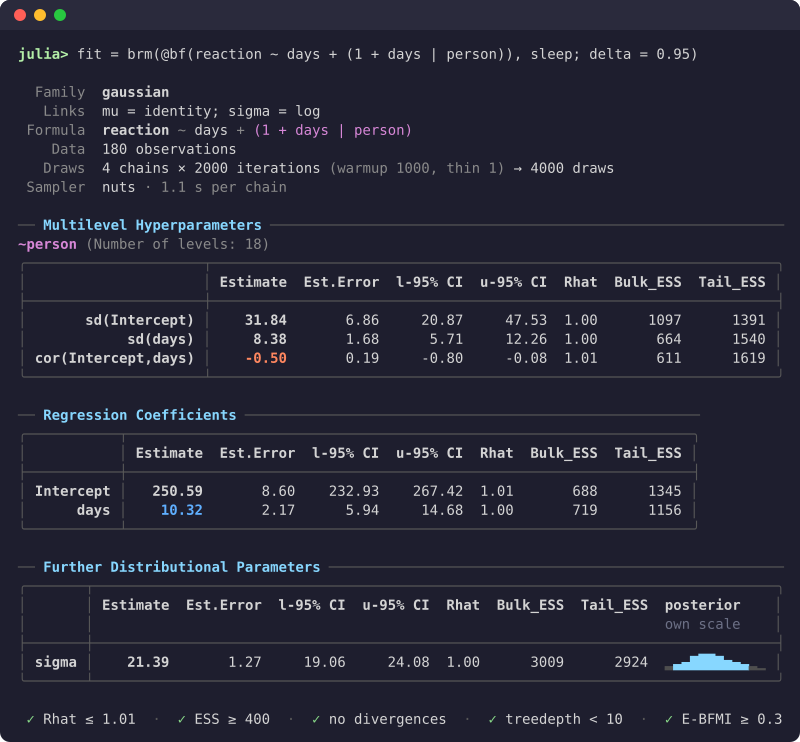

# PracticalBayesianRegression.jl

[](https://EvoArt.github.io/PracticalBayesianRegression.jl/stable/)
[](https://EvoArt.github.io/PracticalBayesianRegression.jl/dev/)
[](https://github.com/EvoArt/PracticalBayesianRegression.jl/actions/workflows/ci.yml)

Bayesian regression models in Julia, written the way R's
[brms](https://paulbuerkner.com/brms/) writes them. The package covers the
model classes brms does: generalised linear and multilevel models,
distributional, ordinal and categorical models, censored and truncated
responses, non-linear models, multivariate models, mixtures, smooths,
Gaussian processes, autocorrelation and spatial terms, measurement error and
missing-data imputation. It uses brms's formula syntax and default priors, and
names the parameters in its output as brms does.

```julia
using PracticalBayesianRegression

fit = brm(@bf(count ~ treatment + (1 | site)), data; family = poisson())
fit                          # summary table
pp_check(fit)                # posterior predictive check (after `using CairoMakie`)
loo(fit)                     # leave-one-out cross-validation
posterior_predict(fit; newdata = new_sites, allow_new_levels = true)
```

A fitted model prints brms's summary, with convergence diagnostics:

<p align="center">
  
</p>

## How it differs from brms and TuringGLM.jl

- **No probabilistic programming language in between.** brms writes Stan
  code and TuringGLM.jl writes a Turing model. This package builds each
  model's log density directly from the formula, with a closed-form gradient,
  and samples it with its own implementation of NUTS (the algorithm Stan
  uses), so that each evaluation of the log density is as fast as possible.
- **Models compile to standalone programs.** The log density, its gradient
  and the sampler compile with `juliac --trim`; `build_binary` turns a model
  into an executable that refits it to new data without Julia (for a subset
  of models so far).
- **Turing and PracticalBayes code on request.** `turing_code` and `pb_code`
  write any fitted model out as an editable `@model`, for changing the model
  by hand. The generated model is not guaranteed to be as fast as the
  package's own.

## Installation

```julia
using Pkg
Pkg.add("PracticalBayesianRegression")
```

The package needs Julia 1.12 or later. Start Julia with several threads
(`julia -t 4`) so that chains run in parallel. Plotting needs CairoMakie,
PlotlyLight or UnicodePlots; `to_inferencedata` needs InferenceObjects.

## Documentation

The [documentation](https://EvoArt.github.io/PracticalBayesianRegression.jl/stable/)
has tutorials, how-to guides (including a page for brms users), a reference
for every function, and an explanation of the design.

## To do

Not supported yet:

- member-specific covariates `mmc()` inside multi-membership terms `mm()`;
- factor-smooth interactions `s(x, g, bs = "fs")` and the rarer smooth bases
  (`bs = "gp"`, `"ad"`, `"so"`, `"mrf"`, ...);
- `unstr()` for non-gaussian families;
- predictions for new data from models with `car()`, `sar()`, `fcor()` or
  latent (non-gaussian) autocorrelation terms (these raise an error);
- `nlf()` (non-linear models take all their formulas in `bf`);
- `knots =` and `Boundary.knots =` in `ns()` and `bs()`;
- the `split` refinement of moment matching in `loo(fit; moment_match = true)`;
- model binaries (`build_binary`) for censored and truncated responses,
  ordinal and categorical families, `mo()`, smooths, Gaussian processes and
  autocorrelation terms; R and Python packages to read their output.

Known differences from brms:

- thin-plate smooths `s(x)` fit the same curves, but their `sds` parameter is
  on a different scale, because mgcv reparameterises the basis internally
  (`bs = "cr"`, `"ps"`, `"cc"` and `"re"` match brms exactly);
- `bs = "cs"` shrinks its null space by a different amount than mgcv, whose
  choice depends on rounding in an eigendecomposition;
- `gammafamily()` uses the log link by default, brms's `Gamma()` the inverse
  link.

## License

MIT
