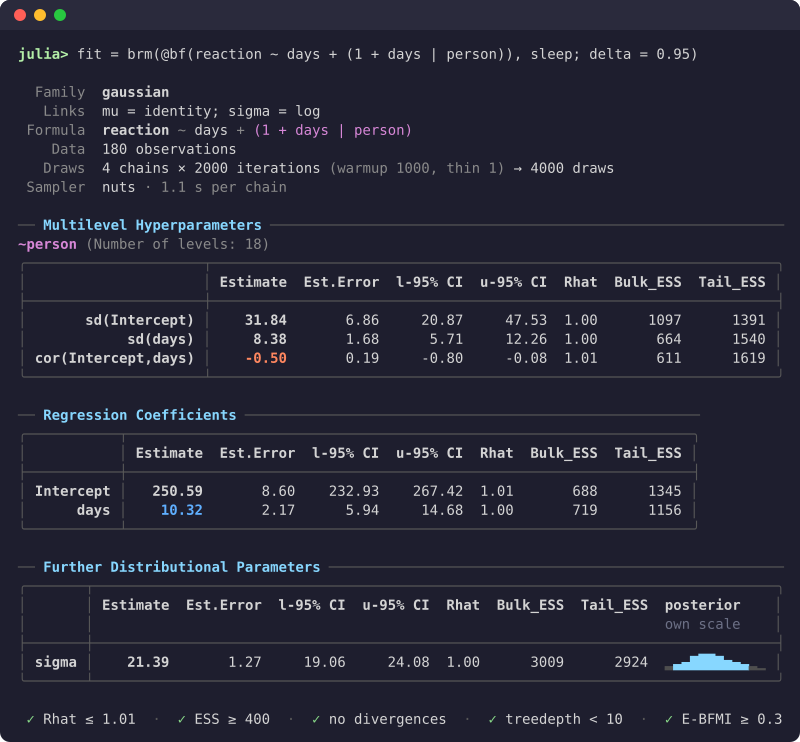

# PracticalBayesianRegression.jl

Bayesian regression models in Julia, written the way R's
[brms](https://paulbuerkner.com/brms/) writes them. The package covers the
model classes brms does: generalised linear and multilevel models,
distributional, ordinal and categorical models, censored and truncated
responses, non-linear models, multivariate models, mixtures, smooths,
Gaussian processes, autocorrelation and spatial terms, measurement error and
missing-data imputation. It uses brms's formula syntax and default priors, and
names the parameters in its output as brms does.

```julia
using PracticalBayesianRegression

fit = brm(@bf(count ~ treatment + (1 | site)), data; family = poisson())
fit                          # summary table
pp_check(fit)                # posterior predictive check (load a plotting package first)
loo(fit)                     # leave-one-out cross-validation
posterior_predict(fit; newdata = new_sites, allow_new_levels = true)
```

A fitted model prints brms's summary, with convergence diagnostics:



## How it differs from brms and TuringGLM.jl

- **No probabilistic programming language in between.** brms writes Stan
  code and TuringGLM.jl writes a Turing model. This package builds each
  model's log density directly from the formula, with a closed-form gradient,
  and samples it with its own implementation of NUTS (the algorithm Stan
  uses). Each evaluation of the log density does as little work as possible.
- **Models compile to standalone programs.** The log density, its gradient
  and the sampler compile with `juliac --trim`. [`build_binary`](@ref) turns a
  model into an executable that refits it to new data without Julia (for a
  subset of models; see [Build a model binary](@ref)).
- **Turing and PracticalBayes code on request.** [`turing_code`](@ref) and
  [`pb_code`](@ref) write any fitted model out as an editable `@model`, for
  changing the model by hand. The generated model is not guaranteed to be as
  fast as the package's own.

## Installation

```julia
using Pkg
Pkg.add("PracticalBayesianRegression")
```

Chains run on separate threads; start Julia with `julia -t 4` (or more) to
use them. Plots are drawn with PracticalBayesPlot, or with CairoMakie,
PlotlyLight or UnicodePlots when one is loaded, and conversion to ArviZ's `InferenceData` needs InferenceObjects.

## Where to go next

- New to the package: start with the [tutorials](@ref "A first model").
- Coming from R: [Coming from brms](@ref) lists what is written differently.
- A specific task: the how-to guides cover priors, families, smooths,
  missing data, predictions, model comparison and more.
- Every function: the reference section.
- Why the package works the way it does: the explanation section.
